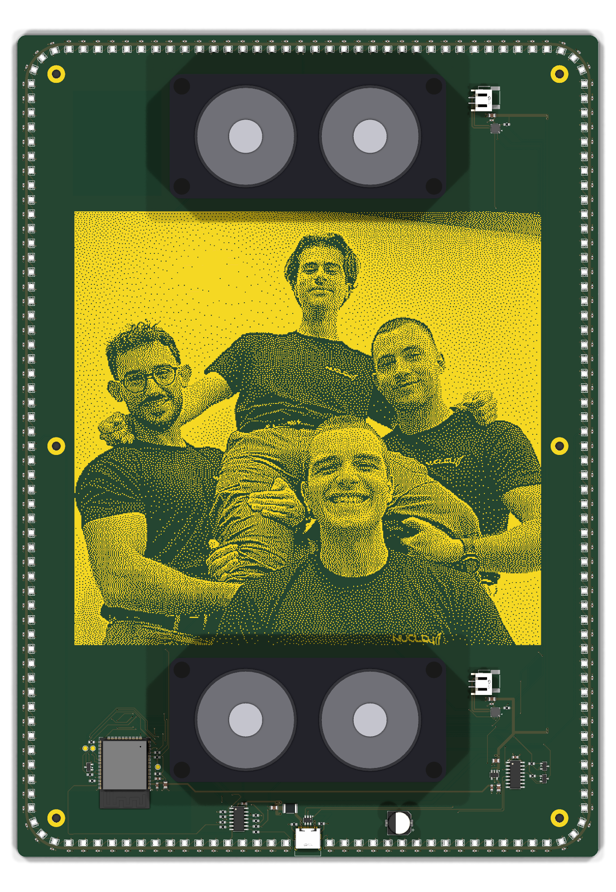

# fra-clock

A one-off gift PCB designed in **KiCad 10**: an ESP32 clock with a ring of 180 WS2812B‑2020 LEDs, a photo printed in exposed copper on the front, two Makerverse 8 Ω / 5 W speakers driven by two MAX98357A I²S amplifiers, USB‑C power/programming (CH340C) and an NFC tag area.



| | |
|---|---|
| Board | 2 layers, 210 × 297 mm (A4), R3 corners |
| MCU | ESP32‑WROOM‑32E |
| LEDs | 180 × WS2812B‑2020 (4 chains, 74AHCT125 level shifter) |
| Audio | 2 × MAX98357A → 2 × JST PH (speakers Core Electronics CE08483) |
| Power / USB | USB‑C (HRO TYPE‑C‑31‑M‑12), 2 A PTC, AP2112K‑3.3, USBLC6‑2SC6, CH340C |
| Status | Routed, DRC clean (0 errors, 0 unconnected), Gerber/drill + JLCPCB BOM/CPL generated. **Not fabricated yet.** |

## Repository layout

```
hardware/                 KiCad project – open hardware/fra_clock.kicad_pro
  fra_clock.kicad_pcb     board
  fra_clock.kicad_sch     root schematic (+ led_ring.kicad_sch sub-sheet)
  fra_clock.pretty/       project footprints (photo art ART_FOTO, speaker outline)
  3d/                     project 3D models (speaker, LCSC/EasyEDA models in lcsc/)
production/
  fra_clock_gerber_jlcpcb.zip   upload this to the fab
  gerber/                 Gerber X2 + Excellon drill (+ drill maps)
  assembly/               JLCPCB BOM and CPL (pick & place)
  preview/                Gerber renders used for the visual check
docs/
  routing-report.md       full design/routing report (Italian)
  checks/                 DRC and verification outputs referenced by the report
  images/                 3D renders
art/
  source/foto.jpeg        original photo
  generated/              dithered bitmap, rectangle list, previews
scripts/                  automation used to build the board (see scripts/README.md)
```

## Ordering (JLCPCB)

1. Upload `production/fra_clock_gerber_jlcpcb.zip` (2 layers, 1.6 mm).
2. Surface finish: **ENIG** keeps the copper photo gold and flat (HASL turns it silver and uneven). Solder-mask colour sets the photo contrast.
3. For assembly upload `production/assembly/fra_clock_BOM_JLCPCB.csv` and `fra_clock_CPL_JLCPCB.csv`, then check rotation / pin 1 in the placement preview (SOT‑23/‑5/‑6, SOIC, TQFN, WS2812B‑2020, ESP32 antenna towards the edge, USB‑C, JST, C69 polarity).
4. Open decisions before ordering: ESP32 flash size (BOM uses N4 = C701341; N8 = C701342, N16 = C701343); stock and prices were not checked.

The NFC tag (NTAG216 sticker) has no footprint and is applied by hand in the keep-out area.

## Regenerating the production files

From the repository root, with KiCad 10 (`kicad-cli`):

```sh
KC=/Applications/KiCad/KiCad.app/Contents/MacOS/kicad-cli
$KC pcb drc --refill-zones --schematic-parity --format json --severity-all -o docs/checks/drc_latest.json hardware/fra_clock.kicad_pcb
$KC pcb export gerbers -o production/gerber/ --layers F.Cu,B.Cu,F.Paste,B.Paste,F.Silkscreen,B.Silkscreen,F.Mask,B.Mask,Edge.Cuts --subtract-soldermask --check-zones hardware/fra_clock.kicad_pcb
$KC pcb export drill -o production/gerber/ --format excellon --drill-origin absolute --excellon-units mm --excellon-zeros-format decimal --excellon-oval-format alternate --excellon-separate-th --generate-map --map-format gerberx2 hardware/fra_clock.kicad_pcb
python3 scripts/production/dump_fps.py hardware/fra_clock.kicad_pcb /tmp/fps.json
(cd production/assembly && python3 ../../scripts/production/make_bom_cpl.py /tmp/fps.json)
```

## Known open points

See `docs/routing-report.md` §5: a ~1035 mm² island of the bottom GND pour around U6/C4 is tied to GND only through top-side bridges; the exposed-pad vias of U101/U102 are not plugged; the `Power` net class is not assigned (widths are set explicitly on the tracks).
